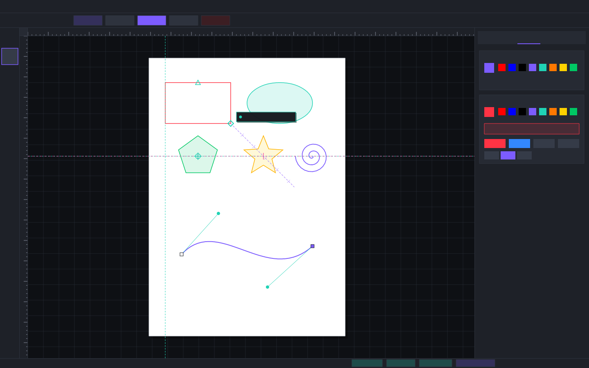

# VDraw

**VDraw** is a professional 2D vector illustration, CAD, and laser-CAM application built in **pure Rust**, featuring a modern desktop interface and real-time GPU-accelerated canvas.



---

## Highlights & Capabilities

- **100% Pure Rust:** Clean-room implementation with zero C/C++ bindings, no Electron, and no webviews.
- **Robust Geometry Engine (`core-geom`):**
  - Primitives: `Point2`, `Rect`, `Affine2` with full 2D affine algebra (matrix transform, inverse, rotation around arbitrary pivot).
  - Cubic Bézier Pipeline: de Casteljau split, exact derivative & curvature evaluation, 5-point Gauss-Legendre quadrature arc length, adaptive flattening within $0.02\text{ mm}$ tolerance, tight derivative-based bounding box.
  - Nearest-point solver combining bounding-box cull, 4-level bisection, and Newton-Raphson refinement clamped to $[0, 1]$.
  - Node continuity mechanics: `Cusp` (independent), `Smooth` ($G^1$ collinear continuity), and `Symmetrical` (mirrored handles) with automatic constraint propagation.
  - Automatic curve fitting using **Philip J. Schneider's algorithm** (Graphics Gems I).
- **Hierarchical Document Model (`core-doc`):**
  - Multi-page (A4 default: $210 \times 297\text{ mm}$) and multi-layer architecture with visibility, locking, and opacity.
  - Shape kinds: `Path`, `Rect` (with corner fillets), `Ellipse`, `Line`, `Polygon` ($N=3..50$), `Star`, `Spiral`.
  - Full Undo/Redo command pattern (`Command`, `UndoStack`, `AddShapeCommand`, `RemoveShapesCommand`, `TransformShapesCommand`, `SetStyleCommand`, `ModifyShapeKindCommand`, `CompoundCommand`).
  - Selection engine with 8 scale handles (opposite anchor pinning) and interactive toggle to Rotate/Skew mode (corner rotation handles, skew handles, center pivot).
- **Interactive Tool State Machine (`core-tools`):**
  - **Pick Tool (`V`)**: Single and multi-selection, marquee drag selection, interactive scaling (Ctrl 1:1 aspect lock), rotation around center pivot (Ctrl 15° snap), translation.
  - **Shape / Node Tool (`F10`)**: Anchor point dragging, control handle manipulation with live constraint enforcement, double-click curve segment splitting, and node deletion.
  - **Freehand Tool (`F5`)**: Real-time digitized stroke capture with Schneider cubic Bézier fitting.
  - **Pen Tool (`B`)**: Click for cusp nodes, drag for smooth handles, live rubber-band preview, path closing.
  - **Rectangle Tool (`F6`)**: Live drag preview, Shift-from-center, Ctrl-square constraint.
  - **Ellipse Tool (`F7`)**: Live drag preview, Shift-from-center, Ctrl-circle constraint.
  - **Polygon Tool (`Y`)**: Regular $N$-sided polygon creation ($3..50$ sides).
  - **Star Tool (`S`)**: Parametric star creation with configurable points and sharpness ratio.
  - **Spiral Tool (`A`)**: Archimedean spiral creation with configurable expansion and turns.
  - **2-Point Line Tool (`L`)**: 2-point line with 15° angle snap.
- **Laser-CAM Readiness:**
  - Automatic hairline classification ($\le 0.1\text{ mm}$).
  - Standard color-role mapping: Hairline Red (`#FF0000`) for **Laser Cut**, Hairline Blue (`#0000FF`) for **Laser Score**, Raster Engrave fills.
  - One-click laser preset styling buttons in the Fill & Stroke panel.
- **Modern Desktop UI (`app`):**
  - Dark charcoal theme with electric violet / teal accent palette.
  - Infinite canvas with adaptive metric millimeter rulers, major/minor tick marks, cursor lines, and grid.
  - Dynamic property bar updating in real time based on active tool and selection.
  - Dockable panels: Object Manager, Fill & Stroke inspector, Align & Distribute, Laser-CAM.
  - Command palette (`Ctrl+K`) for keyboard-driven access to all tools and commands.

---

## Workspace Structure

```
VDraw/
├── crates/
│   ├── core-geom/     Geometry primitives, cubic Bézier math, subdivision, Schneider curve fitting, arc length
│   ├── core-doc/      Document hierarchy, pages, layers, shape normalization, styling, selection, undo/redo
│   ├── core-snap/     Spatial index (R*-tree), SnapSolver, alignment & dynamic guides (Phase 3)
│   ├── core-boolean/  Boolean operations (Weld, Trim, Intersect, Knife) (Phase 4)
│   ├── core-tools/    Tool trait, state machine, Pick, Shape, Pen, Freehand, Rect, Ellipse, Polygon, Star, Spiral
│   ├── core-cam/      Laser role classifier, containment tree, kerf offset, HPGL/G-code export (Phase 5)
│   ├── io/            File I/O (SVG, DXF, PDF export, native .vdraw project format) (Phase 6)
│   └── app/           egui/eframe desktop application binary, theme, canvas, dock layout
├── docs/              Architecture documentation, milestone changelogs, UI screenshots
└── assets/            Theme definitions, fonts, and icon assets
```

---

## Getting Started

### Prerequisites

- Rust stable toolchain (1.75+ recommended):
  ```bash
  curl --proto '=https' --tlsv1.2 -sSf https://sh.rustup.rs | sh
  ```

### Building & Running

```bash
# Clone the repository
git clone https://github.com/Sohil7040/VDraw.git
cd VDraw

# Build and run the desktop application
cargo run --release --bin vdraw
```

### Running Tests & Quality Checks

Every mathematical algorithm and data model is verified with unit tests and property tests (`proptest`):

```bash
# Run all unit and property test suites
cargo test --all

# Run static analysis (must be zero warnings)
cargo clippy --all-targets --all-features -- -D warnings

# Verify formatting
cargo fmt --all -- --check
```

### Headless Screenshot Verification

VDraw includes a headless screenshot generator powered by `tiny-skia` for pixel-perfect UI capture in CI/CD and headless environments:

```bash
cargo run --bin vdraw -- --screenshot output.png
```

---

## Keyboard Shortcuts

| Shortcut | Tool / Action |
|---|---|
| `V` | Pick Tool |
| `F10` | Shape / Node Tool |
| `F5` | Freehand Tool |
| `B` | Pen Tool |
| `F6` | Rectangle Tool |
| `F7` | Ellipse Tool |
| `Y` | Polygon Tool |
| `S` | Star Tool |
| `A` | Spiral Tool |
| `L` | 2-Point Line Tool |
| `Ctrl+Z` | Undo |
| `Ctrl+Y` / `Ctrl+Shift+Z` | Redo |
| `Delete` / `Backspace` | Delete Selection / Selected Nodes |
| `Ctrl+A` | Select All |
| `Ctrl+K` | Command Palette |
| `+` / `-` | Zoom In / Out |
| `0` / `Insert` | Fit Page to Viewport |
| `Escape` | Cancel Active Drag / Clear Selection |

---

## Project Roadmap

- [x] **Phase 0:** Workspace scaffold, CI, theme token system, infinite canvas with rulers & pan/zoom, dock layout.
- [x] **Phase 1:** `core-geom` primitives, Bézier algorithms, `core-doc` hierarchy, Pick/Rect/Ellipse/Line/Pen tools, undo/redo.
- [x] **Phase 2:** Shape/Node tool (`F10`), live handle constraints (`Cusp`, `Smooth`, `Symmetrical`), Schneider curve fitting (`F5`), Polygon/Star/Spiral tools, Fill & Stroke inspector with laser hairline classification.
- [x] **Phase 3:** Snapping system, R*-tree spatial index (0.0055 ms queries on 50k shapes), dynamic 15° polar guides, smart alignment guides, interactive ruler guidelines.
- [ ] **Phase 4:** Booleans (Weld, Trim, Intersect, Exclude), Knife, Eraser, Virtual Segment Delete, curve re-fitting.
- [ ] **Phase 5:** Laser-CAM pipeline, containment tree, inside-out ordering, kerf offset, HPGL/G-code export, simulated laser preview.
- [ ] **Phase 6:** SVG/DXF I/O, native project format (`.vdraw`), PDF/PNG export, dimensioning tools.
- [ ] **Phase 7:** Performance optimization (100k+ nodes at 60 fps), UI polish, Linux packaging (AppImage, `.deb`, Flatpak).

---

## License

Apache-2.0 / MIT.
